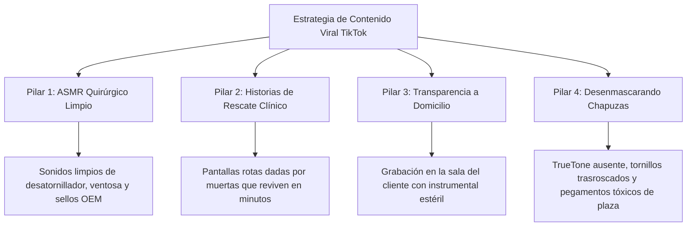
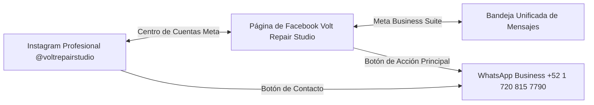

# ⚡ MANUAL OPERATIVO MAESTRO: ARQUITECTURA META ECOSYSTEM Y ESTRATEGIA VIRAL EN TIKTOK
## VOLT REPAIR STUDIO — LABORATORIO DE MICRO-CIRUGÍA DE SMARTPHONES A DOMICILIO

---

## 📌 FICHA TÉCNICA Y POLÍTICAS IRROMPIBLES DE MARCA

| Parámetro | Detalle Oficial |
| :--- | :--- |
| **Marca Comercial** | **Volt Repair Studio** |
| **Propuesta de Valor** | Laboratorio móvil de micro-cirugía para smartphones a domicilio con diagnóstico anatómico clínico y transparencia quirúrgica total en tu presencia. |
| **Garantía Oficial** | **90 días por escrito** en refacción y mano de obra con reporte digital. |
| **Sitio Web Oficial** | [https://anubys6.github.io/volt-repair-studio/](https://anubys6.github.io/volt-repair-studio/) |
| **WhatsApp Oficial** | **+52 1 720 815 7790** ([wa.me/5217208157790](https://wa.me/5217208157790)) |
| **Tarifa Oficial Mano de Obra: Pantalla** | **$700 MXN** (+ costo de refacción certificada Grado A+ / OLED / Original según modelo) |
| **Tarifa Oficial Mano de Obra: Tapa Trasera** | **$500 MXN** (+ costo de refacción cristal templado láser) |
| **Tarifa Oficial Mano de Obra: Batería** | **$500 MXN** (+ costo de celda de alta capacidad con flex original / reprogramación) |
| **POLÍTICA DE CERO MOJADOS** | **ESTRICTAMENTE PROHIBIDO ACEPTAR, PROMOVER O COTIZAR EQUIPOS MOJADOS O CAÍDOS AL AGUA.** Jamás recomendar arroz, tinas de ultrasonido ni limpiezas con isopropílico para equipos en cortocircuito por agua. Volt Repair Studio se enfoca exclusivamente en intervenciones electromecánicas limpias: pantallas, tapas, baterías, flexores y periféricos certificados. |

---

# 📱 PARTE 1: ARQUITECTURA Y CRECIMIENTO EXPONENCIAL EN TIKTOK

TikTok es el motor orgánico de mayor velocidad para construir autoridad y confianza local. En el sector de la reparación de smartphones, el cliente promedio siente temor de ser engañado o de que le roben piezas en locales tradicionales. TikTok es la herramienta para demostrar que Volt Repair Studio trabaja con estándares hospitalarios de orden, higiene y precisión en el propio domicilio del usuario.

---

### 1.1 Configuración de la Cuenta Oficial de TikTok

#### A. Tipo de Cuenta: Cuenta de Empresa (TikTok Business)
1. Descarga la aplicación de **TikTok** e inicia el registro con el correo oficial del estudio o mediante el número móvil **+52 1 720 815 7790**.
2. Ve a tu **Perfil** > Menú hamburguesa (tres líneas superiores) > **Ajustes y privacidad**.
3. Selecciona **Cuenta** > **Cambiar a cuenta de empresa**.
4. Selecciona la categoría: **Electrónica y electrodomésticos** o **Servicios locales / Reparación**.
5. *Beneficios activados:* Acceso a métricas avanzadas de retención por segundo, programación de videos desde desktop, respuestas rápidas automatizadas en mensajes directos (DM) y campo oficial para sitio web y botón de contacto.

#### B. Nombre y Nombre de Usuario (@Handle)
* **Nombre visible (Name):** `Volt Repair Studio ⚡ Celulares a Domicilio`
  *(Incluye palabras clave de búsqueda SEO para que el algoritmo lo muestre cuando alguien busque "reparación celulares domicilio").*
* **Nombre de usuario oficial (@handle):** `@voltrepairstudio`
  - Alternativas en caso de no disponibilidad: `@voltrepair.mx` | `@voltrepairstudiomx` | `@voltrepair_oficial`

#### C. Biografía Magnética de Alta Conversión (Límite: 80 caracteres en TikTok)
TikTok cuenta con un límite estricto de 80 caracteres en la biografía. Debe ser directa, persuasiva y orientada a la acción:

> **Opción Oficial A (Enfoque Quirúrgico & Confianza):**
> ```text
> ⚡ Micro-cirugía de iPhone y Android a domicilio
> 👁️ Reparamos frente a ti en 25 min
> 📲 Agenda aquí 👇
> ```
> *(79 caracteres con espacios y emojis)*

> **Opción Oficial B (Enfoque Tarifas Claras & Garantía):**
> ```text
> ⚡ Especialista en Pantallas y Baterías
> 🚗 A domicilio en tu sala u oficina
> 🛡️ 90 días de garantía 👇
> ```
> *(79 caracteres con espacios y emojis)*

#### D. Estrategia del Enlace en Bio (Link-in-Bio)
1. **Requisito del Enlace Clickeable en TikTok:** TikTok habilita el enlace directo en bio inmediatamente al registrarte como Cuenta de Empresa verificando documentación comercial, o de forma automática al alcanzar 1,000 seguidores en cuenta personal/creador.
2. **URL Principal de Destino:**
   `https://anubys6.github.io/volt-repair-studio/`
3. **Parámetro UTM y Enlace Directo a WhatsApp:**
   Para rastrear a los clientes que provienen de TikTok, el enlace de WhatsApp preconfigurado debe ser:
   ```text
   https://wa.me/5217208157790?text=Hola%20Volt%20Repair%20Studio%2C%20vi%20su%20video%20en%20TikTok%20y%20quiero%20cotizar%20una%20reparaci%C3%B3n%20a%20domicilio%20para%20mi%20equipo.
   ```

---

### 1.2 El Algoritmo de TikTok y la Curva de Retención de 3 Segundos

El 90% de los videos de reparación fracasan en TikTok porque empiezan con un saludo aburrido (*"Hola amigos, hoy les traigo un video..."*). Para el algoritmo de TikTok, los primeros 3 segundos deciden si tu video se muestra a 200 personas o a 500,000.

#### Las 3 Reglas de Oro de Retención:
1. **Visual Hook (Gancho Visual Instantáneo - 0 a 1.5s):** Comienza mostrando el equipo en su estado más dramático (pantalla totalmente destruida, pantalla parpadeando en verde radioactivo, o la apertura quirúrgica de los tornillos pentalobe con luz macro).
2. **Audio Hook (Gancho Auditivo - 0 a 3s):** Sonido crujiente de cristal levantándose (ASMR limpio) o una frase de controversia/curiosidad inmediata.
3. **Curiosity Gap (Brecha de Curiosidad):** Plantea una incógnita que solo se resuelve al final del video (*"El cliente pensó que tenía que tirar su teléfono de $18,000 pesos..."*).
4. **Bucle de Finalización (Loop):** El llamado a la acción final debe empalmar rítmicamente con el inicio del video para que la tasa de finalización supere el 70%.

---

### 1.3 Los 4 Pilares de Contenido Viral de Volt Repair Studio



1. **Pilar 1: ASMR Quirúrgico Limpio (Clean Tech ASMR):**
   - Sin voz o con voz en off minimalista.
   - Enfoque macro en el tapete antiestático azul, el sonido de los desarmadores Wiha / QianLi, el desprendimiento de sellos contra polvo originales y el "clic" satisfactorio de los conectores FPC.
2. **Pilar 2: Historias de Rescate ("El cliente pensó que no tenía arreglo"):**
   - Equipos que en plazas comerciales o servicios autorizados cotizaron cambios de tarjeta lógica completos de $12,000 MXN cuando solo requerían una pantalla certificada Grado A+ y calibración de flex.
3. **Pilar 3: Transparencia Radical a Domicilio (Cero Miedo a Robo de Piezas):**
   - Mostrar el maletín de micro-cirugía abriéndose en una mesa de centro o barra de cocina. El técnico con guantes de nitrilo negros reparando con el cliente presente tomándose un café.
4. **Pilar 4: Desenmascarando Chapuzas Callejeras vs Estándar Volt:**
   - Mostrar cómo abren teléfonos en plazas con pegamento amarillo pegajoso B-7000 chorreado, sellos rotos, tornillos faltantes o sin programar el chip de TrueTone / aviso de pantalla original.

---

### 1.4 Los 5 Guiones Virales de Alta Retención (Listos para Grabar)

---

#### 🎬 GUIÓN 1: "Mi cliente pensó que su iPhone estaba muerto"
* **Duración:** 35 - 45 segundos.
* **Pilar:** Rescate y Autoridad Técnica.
* **Sonido sugerido:** Beat de Synthwave moderno / Lo-Fi Tech + Sonidos reales de taller amplificados.
* **Hashtags SEO:** `#ReparacionCelulares #iPhoneMexico #PantallaRota #AppleHacks #ServicioADomicilio`

| Tiempo | Plano de Cámara | Acción en Pantalla | Texto en Pantalla (On-Screen Text) | Locución Exacta (Voz en Off) |
| :--- | :--- | :--- | :--- | :--- |
| **00:00 - 00:03** | Plano Detalle (Macro 4K). Luz cenital fría. | Un iPhone 13 Pro con la pantalla estrellada y totalmente en negro. El técnico presiona el botón de encendido y no reacciona. | *“Iban a tirar este iPhone de $16,000 pesos a la basura…”* 😱❌ | *“Mi cliente pensó que este iPhone ya no tenía arreglo y que la placa lógica estaba muerta…”* |
| **00:03 - 00:08** | Plano cenital del tapete azul. | Conectamos el multímetro y el detector de consumo USB-C. Muestra consumo de carga normal de 1.8A. | *“La placa está viva: Solo es la pantalla”* ⚡ | *“…pero al conectar nuestro analizador de corriente, detectamos que la placa lógica está viva. Solo era el display destrozado.”* |
| **00:08 - 00:20** | Secuencia rápida (Cortes dinámicos al ritmo del beat). | 1. Retiro de tornillos inferiores.<br>2. Ventosa térmica abriendo el chasis con sonido crujiente limpio.<br>3. Desconexión de batería primero (con spudger de plástico antiestático).<br>4. Transferencia de flexores con pinzas de titanio. | *Paso 1: Apertura quirúrgica limpia 🔬*<br>*Paso 2: Batería desconectada siempre ⚡* | *“Llegamos a su sala, colocamos nuestro tapete de micro-cirugía y retiramos la pantalla dañada sin tocar un solo dato personal.”* |
| **00:20 - 00:32** | Plano medio / Macro. | Conectamos la programadora QianLi para clonar el número de serie del TrueTone. Se transfiere el archivo de pantalla vieja a pantalla nueva Grado A+. | *“Sin perder el TrueTone de Apple 📲✨”* | *“Transferimos el código original para conservar la función TrueTone y montamos una pantalla certificada Grado A+.”* |
| **00:32 - 00:42** | Plano frontal en mano del técnico. | El iPhone enciende mostrando la manzana nítida, abrimos el menú de brillo y activamos TrueTone. Pantalla perfecta a 120Hz. | *“¡Revivió en 25 minutos! 🚀”*<br>*Mano de obra fija: $700 MXN* | *“Resultado: Teléfono como nuevo en 25 minutos frente a sus ojos. Mano de obra oficial: $700 pesos. Agenda tu cita a domicilio al enlace del perfil.”* |

---

#### 🎬 GUIÓN 2: "Reparando un iPhone frente al cliente en su sala"
* **Duración:** 30 - 38 segundos.
* **Pilar:** Servicio a Domicilio, Privacidad y Cero Desconfianza.
* **Sonido sugerido:** Sonido ASMR ambiental de fondo (música acústica chill o jazz lofi).
* **Hashtags SEO:** `#CelularesADomicilio #ReparacioniPhone #PrivacidadTotal #SinDejarElCelular #ServicioLocal`

| Tiempo | Plano de Cámara | Acción en Pantalla | Texto en Pantalla (On-Screen Text) | Locución Exacta (Voz en Off) |
| :--- | :--- | :--- | :--- | :--- |
| **00:00 - 00:03** | Plano general corto. | Se abre una maleta táctica negra rígida con acolchado interior en la mesa de centro de una casa limpia. Se ve una taza de café humeante a un lado. | *“¿Te da miedo dejar tu celular en una plaza? ☕📱”* | *“¿Te da desconfianza dejar tu teléfono días enteros con desconocidos en una plaza comercial?”* |
| **00:03 - 00:10** | Plano medio del técnico con guantes de nitrilo negros. | El cliente está sentado en su sillón trabajando en su laptop mientras el técnico despliega su tapete magnético y herramientas ordenadas milimétricamente. | *“Micro-cirugía en tu sala u oficina ⚡”* | *“En Volt Repair Studio llevamos el laboratorio hasta tu sala o tu oficina. Reparamos frente a tus ojos mientras trabajas o tomas café.”* |
| **00:10 - 00:22** | Plano cenital macro acelerado (Timelapse 3x). | Desensamble suave, retiro de pantalla rota, limpieza de adhesivo viejo en el bisel con hisopo de precisión, instalación de adhesivo contra polvo nuevo original. | *Cero fotos expuestas 🔒*<br>*Cero piezas cambiadas 🛡️* | *“Cero riesgo de que abran tus galerías de fotos privadas. Cero riesgo de que le cambien piezas a tu equipo. Todo ocurre en tus narices.”* |
| **00:22 - 00:34** | Plano detalle encendiendo el celular y entregando el reporte. | El técnico enciende el equipo, le entrega la hoja del Dispositivograma Clínico firmada con garantía por 90 días. El cliente sonríe y sostiene su celular. | *“Garantía por escrito de 90 días 📋”*<br>*WhatsApp: +52 1 720 815 7790* | *“Terminado en 25 minutos y con 90 días de garantía por escrito. No salgas al tráfico: toca el enlace de la bio y mándanos un WhatsApp.”* |

---

#### 🎬 GUIÓN 3: "Por qué en las plazas te quitan el TrueTone (y cómo lo resolvemos)"
* **Duración:** 40 - 50 segundos.
* **Pilar:** Educación de Valor y Desenmascarando Chapuzas.
* **Sonido sugerido:** Beat tecnológico de suspenso / bajo electrónico marcado.
* **Hashtags SEO:** `#TrueTone #iPhoneTrucos #ReparacionApple #CalidadPantallas #VoltRepairStudio`

| Tiempo | Plano de Cámara | Acción en Pantalla | Texto en Pantalla (On-Screen Text) | Locución Exacta (Voz en Off) |
| :--- | :--- | :--- | :--- | :--- |
| **00:00 - 00:03** | Primer plano de una pantalla de iPhone deslizando el Centro de Control. | Se deja presionado el botón de brillo y solo aparecen "Modo Oscuro" y "Night Shift". Falta el botón de TrueTone. | *“¿Por qué tu iPhone perdió esto después de cambiarle la pantalla? 👀❌”* | *“Si alguna vez cambiaste la pantalla de tu iPhone y perdiste esta función… te hicieron una chapuza de plaza.”* |
| **00:03 - 00:12** | Plano medio mostrando dos pantallas sobre el tapete: una genérica con pegote y una Grado A+ certificada. | El técnico señala el integrado EPROM de la pantalla original. | *“El secreto que los técnicos flojos no te dicen 🤫”* | *“Apple empareja el chip de color de tu pantalla original con la placa lógica. Si el técnico no tiene la programadora láser, tu iPhone pierde la calibración de color TrueTone para siempre.”* |
| **00:12 - 00:25** | Plano macro de la programadora QianLi iCopy encendida. | Se conecta el flex de la pantalla rota vieja al zócalo. La pantalla de la máquina pita y dice *“Read OK: Serial transfer complete”*. Luego conectamos la pantalla nueva y presiona *“Write”*. | *“Copiando datos de calibración nativos 💾⚡”* | *“En Volt Repair Studio conectamos tu pantalla rota a nuestra programadora clínica, clonamos el código de fábrica y lo inyectamos directamente en tu refacción nueva Grado A+.”* |
| **00:25 - 00:38** | Plano frontal del iPhone armándose con torquímetro de precisión. | Se cierra el equipo, se desliza el centro de control y ahora el botón de TrueTone se enciende automáticamente adaptando la temperatura de luz. | *“TrueTone recuperado al 100% ✨”* | *“¡Listo! Colores calibrados, brillo automático reactivado y panel a 120Hz funcionando sin fallas.”* |
| **00:38 - 00:48** | Pantalla final con logo de Volt Repair Studio y botón de WhatsApp. | El técnico saluda a la cámara con el teléfono impecable. | *“Mano de obra oficial: $700 MXN”*<br>*Agenda en el link de la bio 📲* | *“Mano de obra oficial fija de $700 pesos a domicilio. Cuida tu inversión y exige calidad quirúrgica. Link en bio para cotizar hoy.”* |

---

#### 🎬 GUIÓN 4: "Desenmascarando un cambio de batería callejero"
* **Duración:** 35 - 45 segundos.
* **Pilar:** Comparativa Callejera vs Calidad Profesional.
* **Sonido sugerido:** SFX de sonido de error "Buzzer" en la chapuza y SFX de "Suwoosh / Campana de éxito" en el trabajo limpio.
* **Hashtags SEO:** `#BateriaiPhone #BateriaInflada #CuidadoConTuCelular #ChapuzasTécnicas #VoltRepair`

| Tiempo | Plano de Cámara | Acción en Pantalla | Texto en Pantalla (On-Screen Text) | Locución Exacta (Voz en Off) |
| :--- | :--- | :--- | :--- | :--- |
| **00:00 - 00:03** | Plano macro abriendo un iPhone. | Se retira la pantalla y debajo de la batería se ven tiras de cinta de doble cara amarilla o cinta gris pegosteada y arrugada. | *“Miren lo que le hicieron a este iPhone en un local cualquiera… 🤦‍♂️🤢”* | *“Miren la barbaridad que le hicieron a este cliente en un taller callejero por ahorrar centavos.”* |
| **00:03 - 00:10** | Plano detalle con pinzas mostrando el pegamento chicloso. | El pegamento está tocando el chasis sin aislar y la batería está doblada por haberla palanqueado con metal. | *“Cinta de doble cara ordinaria: Riesgo térmico ⚠️”* | *“Pegaron la batería con cinta de doble cara normal y doblaron la celda de litio con una espátula de metal. Esto es un peligro térmico real.”* |
| **00:10 - 00:22** | Plano cenital del método Volt. | Limpiamos la bahía de aluminio con solvente dieléctrico. Tomamos los adhesivos elásticos de liberación térmica originales (tiras pull-tabs con lengüeta) y los colocamos milimétricamente alineados. | *“El método Volt: Adhesivos pull-tabs OEM 🛡️”* | *“En Volt Repair Studio limpiamos el chasis e instalamos las tiras adhesivas de liberación elástica originales de fábrica. Si un día necesitas abrirlo, sale suave sin dañar nada.”* |
| **00:22 - 00:33** | Instalación de batería nueva de alta densidad. | Conexión limpia del conector FPC, colocación de placa protectora de metal con sus tornillos pentalobe y tri-point correspondientes sin trasroscar. | *“Celda certificada Grado A+ 🔋⚡”*<br>*Mano de obra fija: $500 MXN* | *“Montamos celda certificada Grado A+ de ciclo cero y torque exacto en los blindajes. Mano de obra oficial: $500 pesos.”* |
| **00:33 - 00:42** | Diagnóstico en pantalla mostrando 100% de condición de batería. | Abrimos Ajustes > Batería > Condición y recarga: 100% Capacidad máxima. | *“100% de vida útil recuperada 🚀”*<br>*Escríbenos al WhatsApp 👇* | *“Tu teléfono vuelve a durar todo el día. Mándanos WhatsApp al +52 1 720 815 7790 o haz clic en la bio para visitarte hoy.”* |

---

#### 🎬 GUIÓN 5: "La prueba de fuego de los 120Hz ProMotion"
* **Duración:** 25 - 35 segundos.
* **Pilar:** Prueba Táctil Rápida (ASMR de Alta Conversión).
* **Sonido sugerido:** Lo-Fi Chill Beats con sonidos de toques y swipes en pantalla amplificados.
* **Hashtags SEO:** `#ProMotion #iPhone13ProMax #PruebaDePantalla #ASMRTecnologico #ReparacionExpress`

| Tiempo | Plano de Cámara | Acción en Pantalla | Texto en Pantalla (On-Screen Text) | Locución Exacta (Voz en Off) |
| :--- | :--- | :--- | :--- | :--- |
| **00:00 - 00:03** | Plano cenital muy cerrado. | El técnico aprieta los dos últimos tornillos inferiores P2 con su destornillador metálico sonando *clic-clic*. | *“Cirugía de pantalla completada en 25 minutos ⏱️⚡”* | *“Cirugía de pantalla completada en 25 minutos exactos en la oficina de nuestro cliente.”* |
| **00:03 - 00:10** | Plano medio. | Con guantes de nitrilo negros, retira la mica plástica protectora de fábrica de la pantalla nueva con un sonido de succión limpio (ASMR puro). | *ASMR Satisfactorio 🎧✨* | *(Solo sonido ASMR de despegado plástico crujiente)* |
| **00:10 - 00:20** | Plano frontal en primer plano. | Abre la app de Notas y selecciona el marcador. Dibuja un patrón de cuadrícula rápido por todos los bordes, esquinas y centro para probar la respuesta táctil sin ningún salto o toque fantasma. | *“Cero toques fantasma / 120Hz ProMotion 🎯”* | *“Test de digitalizador en todas las esquinas: cero toques fantasma, respuesta inmediata y suavidad total a 120Hz.”* |
| **00:20 - 00:30** | El teléfono en mano mostrando la interfaz impecable. | Sosteniendo el teléfono con una mano y mostrando el maletín de Volt detrás. | *“Garantía por escrito de 90 días 🛡️”*<br>*Agenda en el link de la bio 📲* | *“Mano de obra oficial: $700 pesos. Calidad certificada y 90 días de garantía por escrito. Haz clic en el enlace de la bio y vamos a tu domicilio.”* |

---

# 🔗 PARTE 2: VINCULACIÓN BIDIRECCIONAL META ECOSYSTEM
### (FACEBOOK PAGE ⟷ INSTAGRAM PROFESIONAL ⟷ WHATSAPP BUSINESS)

La vinculación correcta dentro del ecosistema de Meta garantiza tres objetivos críticos:
1. **Publicación cruzada simultánea (Cross-posting automático):** Al subir un Reel, Story o Post en Instagram, se publica automáticamente en Facebook (y viceversa) sin perder tiempo ni rehacer el trabajo.
2. **Centralización de mensajes en Meta Business Suite:** Responder los mensajes directos de Instagram, Facebook Messenger y comentarios desde una sola bandeja unificada en tu computadora o teléfono.
3. **Botón oficial de WhatsApp Business directo:** Permitir que cualquier persona que vea tu perfil o anuncio salte al chat de WhatsApp con un solo clic.

---

### 2.1 Requisitos Previos Indispensables
* Una **Página de Facebook (Fan Page)** creada para el negocio: *Volt Repair Studio*.
* Una **Cuenta de Instagram** convertida a perfil **Profesional (Empresa o Creador)**: *@voltrepairstudio*.
* La aplicación de **WhatsApp Business** instalada y configurada en el número **+52 1 720 815 7790**.
* Tu perfil personal de Facebook debe ser el **Administrador con acceso total** de la Página de Facebook y de la cuenta de Instagram.

---

### 2.2 Vinculación Paso a Paso en Meta Accounts Center (Centro de Cuentas)

El Centro de Cuentas de Meta gestiona la identidad compartida y el intercambio de publicaciones entre Instagram y Facebook.



#### Paso 1: Configurar Instagram como Perfil Profesional
1. Abre la aplicación de **Instagram** en tu teléfono móvil.
2. Ve a tu perfil y toca el botón **Editar perfil** o las 3 barras de la esquina superior derecha.
3. Ve a **Configuración y privacidad** > Baja hasta **Para profesionales** y toca en **Tipo de cuenta y herramientas**.
4. Selecciona **Cambiar a cuenta profesional**.
5. Elige la categoría: **Servicio de reparación de teléfonos móviles** o **Servicio local**.
6. Elige: **Empresa** (Business).

#### Paso 2: Conectar la Página de Facebook desde Instagram
1. En tu perfil de Instagram, toca en **Editar perfil**.
2. En la sección **Información pública de la empresa**, busca la opción **Página**.
3. Toca en **Conectar o crear una página de Facebook**.
4. Inicia sesión con la cuenta de Facebook administradora.
5. Selecciona la Página oficial: **Volt Repair Studio**.
6. Toca **Listo** para confirmar el enlace.

#### Paso 3: Configurar el Centro de Cuentas de Meta para Experiencias Conectadas
1. En Instagram, entra a **Configuración y privacidad** > Toca en **Centro de cuentas** (en la parte superior).
2. Toca en **Cuentas** y verifica que aparezcan tanto tu perfil/página de Facebook como tu cuenta de Instagram. Si no aparece Facebook, presiona **Añadir cuentas** y autentícate.
3. Regresa al menú del Centro de Cuentas y toca en **Experiencias conectadas**.
4. Selecciona **Compartir en varios perfiles** (*Sharing across profiles*).
5. En la sección **Compartir desde**, selecciona tu cuenta de **Instagram (@voltrepairstudio)**.
6. En la sección **Compartir en**, selecciona tu **Página de Facebook (Volt Repair Studio)**.
7. En la sección **Compartir automáticamente**, ACTIVA los 3 interruptores:
   - ✅ **Tus historias de Instagram** (*Your Instagram stories*)
   - ✅ **Tus publicaciones de Instagram** (*Your Instagram posts*)
   - ✅ **Tus Reels de Instagram** (*Your Instagram Reels*)
8. Realiza el camino inverso: Selecciona compartir desde **Página de Facebook** hacia **Instagram** y activa publicaciones e historias automáticas.

---

### 2.3 Vinculación en Meta Business Suite (Desde PC / Desktop)

Para gestionar tu taller como un profesional desde la computadora:

1. Ingresa en tu navegador web a: [business.facebook.com](https://business.facebook.com/).
2. Inicia sesión con tu cuenta administradora de Facebook.
3. En la barra lateral izquierda, haz clic en el engrane de **Configuración** (Settings).
4. Ve al menú **Cuentas** > **Cuentas de Instagram**.
5. Haz clic en el botón azul **Añadir / Conectar cuenta de Instagram**.
6. Marca la casilla para permitir el acceso a los mensajes de Instagram en la bandeja de entrada.
7. Introduce el usuario y contraseña de `@voltrepairstudio`.
8. Una vez conectada, verás ambas cuentas (Facebook Page e Instagram) vinculadas con estado: **Activo y Sincronizado**.

---

### 2.4 Integración del Botón de WhatsApp Business en Ambas Plataformas

El botón de WhatsApp es el embudo de conversión más directo de todo tu sistema publicitario.

#### A. Integración en Instagram Profesional:
1. Abre **Instagram** en tu móvil y ve a tu perfil.
2. Toca en **Editar perfil**.
3. Baja hasta la sección **Opciones de contacto**.
4. Selecciona **Número de teléfono de WhatsApp Business**.
5. Escribe el número: **+52 1 720 815 7790**.
6. Meta enviará un código de verificación de 5 o 6 dígitos directamente a tu aplicación de WhatsApp Business.
7. Ingresa el código en Instagram.
8. Activa la casilla **Mostrar información de contacto en el perfil**.
9. *Resultado:* Aparecerá un botón destacado que dice **WhatsApp** justo debajo de tu biografía, permitiendo a los clientes abrir tu chat con un solo toque.

#### B. Integración en la Página de Facebook:
1. Abre tu **Página de Facebook (Volt Repair Studio)** desde la app de Facebook o desde la computadora.
2. Toca los tres puntos `...` o el botón **Gestionar / Editar botón de acción**.
3. Selecciona **Cambiar botón** > Elige **Enviar mensaje de WhatsApp**.
4. Introduce el número: **+52 1 720 815 7790**.
5. Ingresa el código de confirmación recibido en tu WhatsApp Business.
6. En la configuración de la página, activa la opción **Usar WhatsApp como botón de la página principal**.
7. *Resultado:* En la cabecera de tu página de Facebook, el botón azul principal será **Enviar mensaje de WhatsApp**.

---

### 2.5 Checklist Operativo de Pruebas y Validación de la Red

Antes de lanzar la primera campaña o video, completa esta lista de verificación:

- [ ] **Prueba de Cross-Posting de Historia:** Sube una historia de prueba en Instagram con una foto de tu mesa de trabajo. Abre tu página de Facebook y confirma que apareció simultáneamente en las Facebook Stories dentro de los siguientes 30 segundos.
- [ ] **Prueba de Cross-Posting de Reels:** Sube el Guión 1 en Instagram Reels. Verifica que se haya replicado automáticamente en Facebook Reels con el mismo audio y texto.
- [ ] **Prueba de Clic en WhatsApp (Instagram):** Pídele a un conocido que entre a tu perfil de Instagram desde su propio celular y presione el botón **WhatsApp**. Debe abrir su app de WhatsApp lista para enviarte mensaje.
- [ ] **Prueba de Clic en WhatsApp (Facebook):** Comprueba que el botón principal de la Fan Page redirige inmediatamente a la conversación de WhatsApp con el número **+52 1 720 815 7790**.
- [ ] **Bandeja Unificada en Meta Business Suite:** Envía un mensaje de prueba desde una cuenta secundaria a Instagram y otro a Facebook. Comprueba que ambos aparecen en la pestaña **Bandeja de entrada (Inbox)** de Meta Business Suite.

---

# 🚀 RESUMEN EJECUTIVO DE ACCIÓN INMEDIATA

1. **Paso 1 (TikTok):** Crear `@voltrepairstudio`, convertir a Cuenta de Empresa, pegar la bio magnética oficial y el enlace a la web `https://anubys6.github.io/volt-repair-studio/`.
2. **Paso 2 (Meta):** Unificar Facebook Page e Instagram en el Centro de Cuentas, activar publicación cruzada simultánea de Reels/Stories y vincular el botón de WhatsApp **+52 1 720 815 7790**.
3. **Paso 3 (Producción):** Grabar los 5 guiones virales comenzando con el *Guión 1: "Mi cliente pensó que su iPhone estaba muerto"*, respetando las tarifas oficiales de mano de obra ($700 pantalla, $500 tapa, $500 batería) y la regla estricta de CERO mojados.
